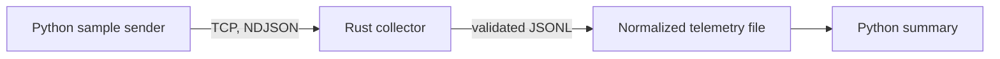

# Baseball Telemetry System

A Linux-first telemetry pipeline that sends newline-delimited JSON over TCP to a Rust collector. The collector validates and timestamps each sample, appends normalized records to a JSON Lines file, and a Python consumer reports summary statistics.

The repository also contains cross-platform CI workflows and an experimental QEMU boot path. The QEMU guest is not yet connected to the TCP pipeline, and the C++ target is currently a build stub; neither is presented as part of the working end-to-end demo.

## Data flow



For the first milestone, the Python sender simulates a device on the Linux host. This keeps the transport, validation, persistence, and analysis path reproducible without requiring a QEMU image or a particular host setup.

## Run the Linux demo

Requirements: Linux, Python 3, Rust stable with Cargo.

From the repository root:

```bash
chmod +x scripts/run_linux_demo.sh
./scripts/run_linux_demo.sh
```

The script builds and starts the Rust collector, sends five telemetry samples over TCP, stops the collector, and prints a summary from the normalized JSONL output. Run artifacts are written to a temporary directory and its path is printed at the end.

To keep artifacts in a known location or change the listener address:

```bash
TELEMETRY_DEMO_OUTPUT_DIR="$PWD/demo-output" \
TELEMETRY_BIND_ADDR="127.0.0.1:9000" \
./scripts/run_linux_demo.sh
```

The demo output directory is not cleared automatically. Remove or rename it before a later run if you want a fresh output file.

The components can also be run separately:

```bash
# Terminal 1: start the collector
cargo run --manifest-path rust_collector/Cargo.toml

# Terminal 2: send data and summarize the default output file
python3 python_app/src/send_samples.py
python3 python_app/src/main.py
```

The collector listens on `127.0.0.1:9000` by default. Set `TELEMETRY_BIND_ADDR` to change it. Set `TELEMETRY_OUTPUT_FILE` to choose the normalized JSONL path; otherwise the collector writes to `sample_data/normalized_telemetry.jsonl` in the repository.

## Telemetry record

The sender transmits one JSON object per line. The Rust collector rejects malformed or out-of-range records, adds `host_timestamp`, and persists accepted records.

```json
{
  "source_id": "linux-demo-sensor",
  "guest_timestamp": "2026-10-29T16:00:00.000Z",
  "pitch_velocity_mph": 94.0,
  "spin_rate_rpm": 2600,
  "wind_speed_mph": 4.5,
  "wind_direction_deg": 135,
  "temperature_f": 68.0,
  "device_status": "ok"
}
```

## Repository layout

| Path | Purpose |
| --- | --- |
| `rust_collector/` | Async TCP server, JSON parsing, validation, timestamp normalization, and JSONL persistence |
| `python_app/src/send_samples.py` | Deterministic Linux-host telemetry sender |
| `python_app/src/main.py` | JSONL reader and telemetry summary |
| `scripts/run_linux_demo.sh` | Starts the collector, runs the sender and analyzer, and manages the demo process |
| `.github/workflows/` | Incremental Windows and Linux CI workflows, including experimental QEMU work |
| `scripts/init` and `config/` | QEMU guest initialization and profile configuration; not yet wired into the TCP demo |
| `cpp_app/` | C++ build stub; not yet an implemented pipeline component |

## CI workflows

The repository contains phased GitHub Actions workflows. They target self-hosted Windows and Linux runners; phase 8 runs on pushes. The Linux demo above is the simplest way to explore the current data path locally.

## Next engineering steps

1. Add meaningful automated tests for validation, file persistence, and summary calculations.
2. Connect the QEMU guest to the collector and emit the same telemetry schema.
3. Give the C++ component a defined responsibility, or remove it from the claimed system architecture until it has one.
4. Consolidate the phased CI workflows after the local Linux path is established.

## License

No license has been selected yet. Until one is added, reuse and redistribution terms are not defined.
